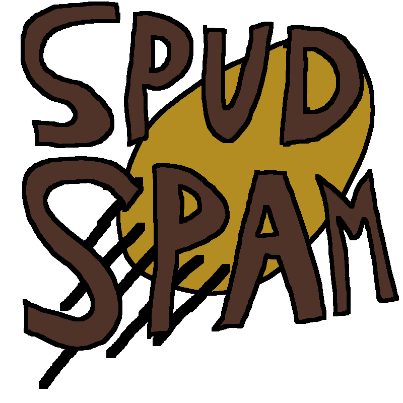

# Spud-Spam

I made a game called Spud Spam, which is about defending your territory with a potato cannon from fruits and veggies!

# How it Was Made
This game was made entirely in Python, utilizing the library Pygame. It took about 10 hours to create, and taught me a lot about classes, functions, etc.

# How to Play
## Installation
To install, download the zip file under the first release, extract all, and run "main.exe."
## Gameplay
To play, aim at enemies and tap or hold down to shoot. Buy upgrades in the bottom right to either increase fire rate, increase potato count per fire, or increase money per enemy kill.
